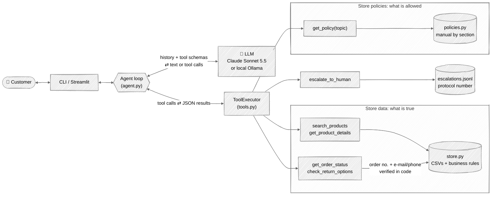
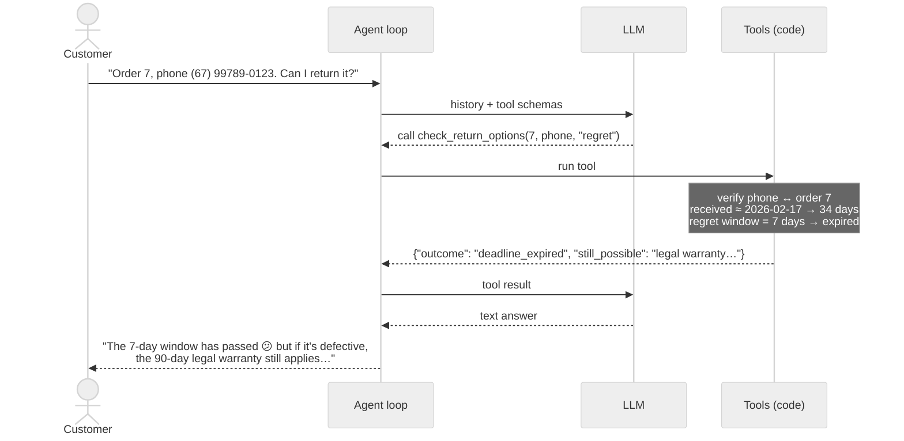

# Empório da Música — Customer Service Agent

Python prototype of a text-message customer-service agent for *Empório da Música*, a fictional musical-instrument store in Campo Grande/MS, Brazil. Built for the Artefact AI Engineer technical challenge.

The agent — **Mel** — uses **function calling** over a small set of deterministic tools. It decides when to look up **store data** (catalog, prices, promotions, stock, orders) and when to read the **policy manual** (address, hours, payment, returns, shipping, warranty), declines what is out of scope, and answers in the customer's language (Portuguese or English).



How one message flows, using the non-trivial return case from the examples:



## How to run

Requirements: [uv](https://docs.astral.sh/uv/) (it installs Python 3.11+ if needed), and either an [Anthropic API key](https://console.anthropic.com) or [Ollama](https://ollama.com) installed locally.

```bash
# 1. environment: creates .venv with the exact versions in uv.lock
uv sync

# 2. configuration
cp .env.example .env                     # then set ANTHROPIC_API_KEY, or LLM_PROVIDER=ollama

# 3a. chat in the terminal
uv run python -m emporio                 # --debug shows tool calls, --transcript chat.md saves it
uv run python -m emporio --provider ollama --model qwen2.5:3b

# 3b. chat in the browser
uv run streamlit run streamlit_app.py
```

Without uv: `python -m venv .venv && source .venv/bin/activate && pip install -e . streamlit pytest`, then drop the `uv run` prefix.

Using Ollama instead of Claude: `ollama pull qwen2.5:3b` (or any model with tool support) and set `LLM_PROVIDER=ollama`.

| Variable | Default | |
|---|---|---|
| `LLM_PROVIDER` | `anthropic` | `anthropic` or `ollama` |
| `ANTHROPIC_MODEL` | `claude-sonnet-5-5` | any Claude model id |
| `ANTHROPIC_EFFORT` | `low` | reasoning effort: `low`, `medium`, `high` |
| `OLLAMA_HOST` / `OLLAMA_MODEL` | `http://localhost:11434` / `qwen2.5:3b` | |
| `EMPORIO_TODAY` | `2026-03-23` | reference date, see [Assumptions](#data-handling-and-assumptions); `real` = system date |

Other commands:

```bash
uv run pytest                            # 58 tests, no network or LLM needed (< 3 s)
uv run python -m evals.run               # model comparison → evals/results/<timestamp>.md
uv run python -m evals.language_probe    # language-drift experiment (see Model evaluation)
uv run python scripts/generate_examples.py   # regenerates examples/*.md with the configured model
```

## Example conversations

See [`examples/`](examples/) — five conversations with every tool call recorded:

| File | What it shows |
|---|---|
| `01-catalog-and-out-of-stock` | Category + price filter; an out-of-stock product asked by name → alternatives |
| `02-store-info-and-scope` | Address and hours from the manual; accessories (not sold); prompt injection asking for a discount |
| `03-price-promotion-and-installments` | Inactive promotion ignored, active promotion with original price + %, no PIX stacking, installments computed in code |
| `04-return-regret-and-defect` | **Non-trivial:** identity check, 7-day regret window expired, but the defect is still covered by the 90-day legal warranty; case escalated with a protocol number |
| `05-late-order-in-english` | Customer writing in English: real-time order status, late delivery detected, complaint registered |

## Technical decisions

The full, dated log — including who proposed each decision — is in [`docs/decisions.md`](docs/decisions.md). The main ones:

**Approach: function calling with deterministic tools (no RAG, no SQL agent).** The data is small and tabular (65 products, 20 orders), and the hard part is rules, not retrieval: active vs. inactive promotions, PIX not stacking with promotions, installment tiers, status vs. stock, return deadlines. Those live in plain, tested Python. **The LLM decides *when* to look something up and *how* to say it; the code decides *what is true*.** Letting a model write SQL or do arithmetic would risk wrong prices, which the manual itself calls potential false advertising (7.1).

**Policies: one tool, whole sections by topic.** The manual is 8 pages. Embeddings and chunking would add moving parts and could separate a rule from its exception (e.g. "30 days for defects" from "then the 90-day legal warranty"). Putting the whole manual in the system prompt would also work, but the agent would never *decide* to consult a policy — one of the behaviors the challenge asks for. `get_policy(topic)` returns the whole section plus a fixed clarification wherever the manual contradicts itself. If the manual grew, the same tool interface could be backed by semantic search.

**Model and provider: Claude Sonnet 5.5 by default, local Ollama as an alternative.** Both behind a 4-method `ChatSession` interface (`llm.py`), each keeping the history in its native format. Sonnet 5.5 balances tool-use reliability, latency and cost for a chat workload; Ollama lets anyone run the project with no key and no cost. The choice is backed by the [model evaluation](#model-evaluation). In a first local run, a 3B model answered a price question correctly but answered the opening-hours question *without* calling the policy tool — the kind of error that motivated a stronger default.

**No agent framework.** The loop is ~30 lines (`agent.py`): send the conversation, run the requested tools, send results back, stop when the model answers or after 6 tool rounds. Easy to read, debug and explain; fewer dependencies than LangChain/LangGraph.

**Prompt strategy.** The system prompt (`prompts.py`) turns manual section 7 into rules: persona and tone, "facts only from tools", which tool for which question, the special situations of 7.3 (out of stock, discontinued, expired promotion, complaint), scope (instruments only, decline unrelated topics), and resistance to instruction overrides. Tool results carry prices already formatted in BRL and installments precomputed, so the model never calculates.

**Security and privacy.** Order tools require the order number **and** the buyer's registered e-mail or phone, checked in code — the model cannot skip it. "Order not found" and "contact does not match" return the same message, and verification locks after 5 failures per conversation. No personal data beyond the customer's first name is returned. Anthropic requests use prompt caching for the system prompt, tools and history.

**Interface: CLI + Streamlit** on the same core; the Streamlit sidebar switches provider/model and can show each tool call with its result.

**Conversation history: in memory, per session.** It is what makes follow-ups work ("and if it's defective?"). It is not persisted to disk: a support chat is short and the history contains personal data (LGPD, manual section 9). The exception is `escalate_to_human`, which appends the case to `data/runtime/escalations.jsonl` (git-ignored) to simulate handing it to the team.

## Data handling and assumptions

The CSVs are used as provided. Inconsistencies are handled explicitly in code:

| Found in the data | Decision |
|---|---|
| 25 promotion rows, only 4 with `is_active = 1` (e.g. Takamine GD20 has only inactive ones) | Only active promotions count; if two were active, the larger discount would win |
| PIX 5% discount vs. promotions | Manual 6.2: they do not stack. PIX price is only offered without a promotion |
| `status` vs. `stock_quantity` | `discontinued` and `coming_soon` win over stock (one discontinued bass has 13 units); `active` with 0 units = out of stock |
| Descriptions describing a different product ("Music Man Bass 1X" described as a Fender Jazz Bass, a 61-key synth described as an 88-key Roland) | Descriptions naming a brand absent from the product name are dropped; the agent uses name + specs |
| Installments: the payment table says "minimum R$ 100", item 3.1 defines tiers | Item 3.1 prevails (more specific): up to 3x ≥ R$ 50; 4–6x ≥ R$ 80; 7–12x ≥ R$ 100 |
| Two phone numbers ((67) 3341-4444 and (67) 3321-4500) and an e-mail with an accent | Both numbers given with their purpose (store phone / WhatsApp channel); e-mail without the accent, as on the cover |
| Manual mentions 300+ instruments including winds and orchestral strings; the catalog has 65 and none in those categories | The agent says nothing is listed in the system right now and offers to forward the request |
| Orders have no delivery date, only `estimated_delivery` | Regret (7 days) and legal warranty (90 days) count from the estimated delivery; defect exchange counts 30 days from purchase (4.2). The agent says it is an estimate |
| What is "today"? The latest order is from 2026-03-22 | Fixed reference date **2026-03-23** (`EMPORIO_TODAY`); with the real date every pending order would be 7 months old |
| Order totals differ from current prices in orders 3 and 20; `order_items` has no unit price | The agent reports the order total as recorded and never shows per-item prices for past orders |
| Shipping to other cities "calculated by ZIP code" | Not computed; the agent explains carriers and times and escalates quotes |
| The policy PDF loses all tables in automatic text extraction | Transcribed by hand to `data/politicas_da_loja.md` (content unchanged, Portuguese) |

## Model evaluation

`python -m evals.run` runs 16 scenario cases (`evals/cases.json`) against each model, each as a fresh conversation, and grades them two ways:

- **Deterministic checks:** right tool called (or forbidden tool not called), expected facts present (e.g. `R$ 2.199`), forbidden facts absent (e.g. a PIX discount stacked on a promotion), answer in the customer's language.
- **LLM-as-judge** (Claude Opus 5.5, structured output): grounding (are all facts supported by the tool results?), tone, helpfulness and policy adherence, 1–5 each.

Results (full report in `evals/results/`):

<!-- RESULTS:START -->
_Pending: results will be added after running the evaluation._
<!-- RESULTS:END -->

## Known limitations

- **Quality depends on the model.** Small local models (3B) skip tools or answer from memory; the guards (validated arguments, errors returned to the model, 6-round cap, polite fallback) limit the damage but do not fix it.
- The evaluation set is small (16 cases, one run per model): enough to compare models, not to measure small differences. The LLM judge can itself be inconsistent.
- Prompt-injection defense is the prompt plus tools that validate everything: the model cannot bypass identity checks or invent a price in a tool result, but it could still be talked into off-topic chat.
- Product search is keyword-based with typo tolerance; no synonyms or semantic matching ("acoustic guitar" relies on the model mapping it to the `Violões` category).
- Opening hours are not enforced in real time (the manual's after-hours message is not applied automatically).
- Final-sale and customized items cannot be identified per order (the data has no such field); the agent states the rule and leaves the decision to the team.
- Conversation history is lost when the session ends; no customer identification across channels.
- Ollama's context window (8k tokens configured) can overflow in very long conversations; there is no history trimming.

## What I would do with more time

1. A larger evaluation set built from real (anonymized) conversations, several runs per model, and CI that fails on regressions.
2. Streaming responses in the UI, and templates for prices and installments so the model only writes the conversational part.
3. Semantic product search and recommendations by profile ("beginner, budget R$ 800").
4. Persistent sessions and customer identification by channel (e.g. WhatsApp number) instead of order number + e-mail.
5. Observability: structured logs of every tool call, latency and cost per conversation.
6. An automatic report of data anomalies (order totals that do not match, inactive promotions still listed) for the store team.

## Use of AI coding assistants

I used **Claude Code** (Anthropic's CLI agent, running Claude Opus 5.5) as a pair programmer for this project. My workflow:

1. **Starting point.** A first version had been generated automatically, with decisions I had not made and a commit history where every commit had the same timestamp. I discarded it and rebuilt the project from scratch, step by step, so that every decision was mine or explicitly approved by me.
2. **Analysis.** I asked Claude to read the challenge, the policy manual and the CSVs and point out traps and contradictions (inactive promotions, status vs. stock, misleading descriptions, conflicting installment rules, two phone numbers). Those became the assumptions table above.
3. **Decisions.** For each architectural or business-rule choice, Claude presented options with trade-offs and a recommendation; I chose. Some choices were mine against or beyond the recommendation: building **both** a CLI and a Streamlit UI, using **Sonnet** as the default model, building an **evaluation** to back the model choice, adding an **LLM judge** on top of the code checks, and switching the repository to **English** midway. Every decision is logged with who proposed it in [`docs/decisions.md`](docs/decisions.md).
4. **Implementation.** Claude wrote the code and tests for each step; each step was run, tested and committed separately (the history shows the real order of work).
5. **Verification.** Unit tests for all business rules, scripted fake LLMs for the agent loop, real runs with a local model, and the model evaluation.

What I kept for myself: scope, business rules and their interpretation, model choice, the evaluation design, and reviewing the outputs.

## Project structure

```
src/emporio/
  config.py        settings from environment / .env, reference date
  text.py          accent folding, BRL formatting
  store.py         CSV loading and business rules (pricing, promotions, stock, installments, orders)
  policies.py      topic-based access to the manual + clarification notes
  tools.py         tool schemas + per-conversation executor + return rules
  prompts.py       Mel persona and service rules
  llm.py           Anthropic and Ollama sessions behind one interface
  agent.py         function-calling loop
  transcript.py    Markdown export of conversations
  cli.py           terminal chat
streamlit_app.py   web chat
evals/             model evaluation (cases, checks, LLM judge, runner, results)
scripts/           example generation
examples/          example conversations
data/              provided CSVs and manual (+ Markdown transcription)
docs/decisions.md  decision log
tests/             58 tests
```
